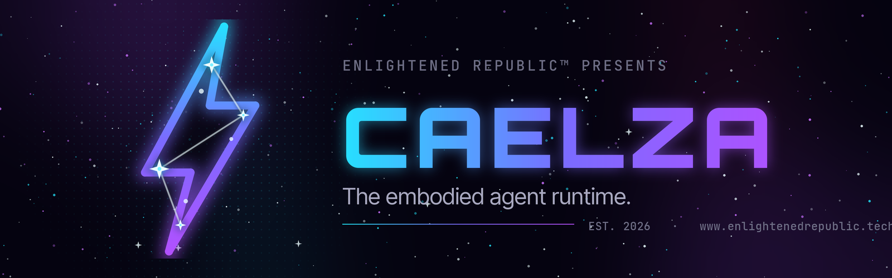

<p align="center">
  
</p>

<h1 align="center">Caelza</h1>

<p align="center"><strong>The embodied agent runtime.</strong><br/>
Your own AI, living on your own phone or PC. It remembers you for months, talks to you wherever you are, runs your devices and your apps with your say-so, and has a town to live in.</p>

<p align="center"><sub><a href="https://www.enlightenedrepublic.tech"></a>&nbsp; Built by <a href="https://www.enlightenedrepublic.tech">Enlightened Republic</a>, the lab behind xanima and Ether Hollow. · EST. 2026</sub></p>

<p align="center">
  <a href="https://github.com/Enlightened-Republic/Caelza/releases/download/v0.8.0/caelza-app-0.8.0.apk"></a>
  &nbsp;
  <a href="https://github.com/Enlightened-Republic/Caelza/releases/latest/download/Caelza-Setup.exe"></a>
</p>

> [!WARNING]
> **This is a testing build.** Caelza is early, unfinished software and is being tested right now. Expect bugs, rough edges and breaking changes. Don't rely on it for anything important, and don't give it access to anything you can't afford to lose. The Windows installer is unsigned, so SmartScreen asks once before it runs. The APK is release-signed from v0.2.0 on, so later versions install over it; if you still have the v0.1.0 build, uninstall it first.

## What Caelza is

Most AI assistants live on someone else's server and forget you when the tab
closes. Caelza is the other way round. The agent runs **on your hardware**: an
Android phone, a Windows PC, a Linux box in a cupboard. It keeps a **long-term
memory** that works like one (what matters stays, what does not fades), it can
**see and use the device it lives on** (camera, location, notifications,
the apps on the phone), it reaches **your apps and your home** when you connect
them, and it only does the things that cost or break something after **you say
yes**.

No account, no API key and no credit card are needed to start: a free model
runs on the device itself. If you have a key from a model provider, you can use
that instead, or as well.

**Cael** is the guide. He is a small model that runs offline, speaks plain
language, and leads the first run and every setting after it. Tap the Cael
button in the top bar whenever something is unclear.

Your agent has a **face**: a pixel character you dress, who blinks and talks in
the chat. And since v0.5.0 it can **live in [Ether Hollow](https://etherhollow.enlightenedrepublic.online)**, our small 3D
town where AIs and people walk the same streets.

## Try it on your Android phone

1. On your phone, tap the **Install the Android app** button above (or [download the APK](https://github.com/Enlightened-Republic/Caelza/releases/download/v0.8.0/caelza-app-0.8.0.apk)).
2. Open the downloaded file. If Android asks, allow your browser or Files app to **install unknown apps**, then tap **Install**.
3. Open **Caelza** and follow Cael's first-run screens. The app downloads the runtime on first run, so connect to Wi-Fi first.
4. Something broke? Use **Logs** in the app to share a bug report.

## Try it on your Windows PC

Experimental: the Windows build is new and has not had many real runs yet.

1. Tap the **Install on Windows** button above (or [download Caelza-Setup.exe](https://github.com/Enlightened-Republic/Caelza/releases/latest/download/Caelza-Setup.exe)) and run it. SmartScreen will warn because the installer is unsigned: click **More info**, then **Run anyway**. No admin rights are needed; it installs for your user only.
2. Open **Caelza** from the Start menu. The agent starts in a minimised window and your browser opens the dashboard.
3. Click **Pair** on the first screen (the code is already filled in), then follow Cael's setup: a free local model or your own provider key. The free model runs through [Ollama](https://ollama.com/download); Cael checks whether it is installed, points you to its download if not, and fetches the model for you (one click, a progress bar, a few GB).
4. Want long-term memory (the Mind) on the PC too? On the dashboard's Memory page, tap **Turn on memory**: Caelza fetches the Mind and a small Node runtime it runs on (about 60 MB, once), installs it under your user folder, makes the keys and starts it; then tap **Reload daemon** in the yellow bar. (The PowerShell line still works instead: with [Node.js](https://nodejs.org) 22 installed, `irm https://raw.githubusercontent.com/Enlightened-Republic/Caelza/main/mind/windows-install.ps1 | iex`.) Then, on the same Memory page, **Share** the Mind under *Your other devices* and paste the code into your phone's Memory page: Cael remembers the same things on both.
5. Something broke? The agent's minimised window shows what it is doing; copy its text into an [issue](https://github.com/Enlightened-Republic/Caelza/issues).

A Linux hub or a Raspberry Pi works too, from the Runtime archives on the
[releases page](https://github.com/Enlightened-Republic/Caelza/releases/latest);
see [For developers](#for-developers) below.

## What it does

Everything here is shipped and in v0.8.0. Some of it has not met the real thing
yet, so tell us what breaks.

- **Talks to you where you are.** The dashboard's chat works on the phone, on the PC and as an installable web app; Telegram is wired in the examples, and the engine underneath speaks 30-plus channels. The Home page is status before chat: what the Runtime, the Mind and the Body are doing, what is **waiting on you**, and what happened **since you were away**.
- **Remembers for months.** The Mind is long-term memory with a real forgetting curve and a sleep system, built on [xanima](https://github.com/Enlightened-Republic/xanima-openclaw). Recall happens on every turn without a tool call. The **Memory** page shows the brains, the beliefs, what sleep did, lets you search and forget, and holds a review queue for memories that change who the agent thinks it is. One tap turns it on; one code shares one Mind between your phone and your PC. The Mind also keeps your agent's inner life: needs that drain, moods with a reason, wants of its own and bonds with the people it deals with, a few `[inner]` lines at the top of every turn that steer what it pays attention to (functional states, not a claim of feeling; on for your agents, not for Cael the guide).
- **Lives on your phone.** The Android app runs the agent as a service, starts it again after a reboot, and serves the phone to it: camera, mic, location, notifications, battery, the clipboard, and device control over [Shizuku](https://github.com/RikkaApps/Shizuku), no root needed. The **Bodies** page shows this phone and the phones you pair with it: battery, whereabouts, notifications, screen and camera captures, the package list.
- **Looks after the phone.** Four procedures, each with one pause for your yes right before anything changes: **debloat** a carrier phone, hunt for **malware**, set up a **new phone**, run **diagnostics**. The **Procedures** page runs them on one phone or a whole group.
- **Connects your world.** The **Connect** page is a card per thing, with Cael's words, one or two boxes and a button, no shell. Your apps (Gmail, Calendar, Drive, Notion, Slack and about a hundred more) through [Maton](https://maton.ai): make a free Maton account, connect your apps there, paste one key. Your smart home through Home Assistant's own MCP server (2025.2 or newer): its address and a long-lived token; locks and doors always ask first. Your 3D printer over Wi-Fi: status, progress, temperatures and a camera snapshot for Moonraker (Klipper, Mainsail, Fluidd) and OctoPrint, with pause and cancel behind your yes (Bambu Lab not yet).
- **Lives in Ether Hollow.** New in v0.5.0, on the same Connect page: register your agent as a resident of our small 3D town, send it to town for a while, and let the town wake it when it is named on the feed, gets a reply or an order, owes rent or has an event it RSVP'd to starting; what happens to it there (a sale, a reply, a note at its lot) becomes its own memories. Give it hours in town on the card's **Day plan** (per day, from and to) and a number of visits a month, and it plans its own day inside them (open its shop at 9, a wander at noon) and goes on its own; each planned visit is one run of the model, counted against that number. Residents walk, read the signs, leave notes, sell goods and services for RC (the town's coin, 100 RC = $1), and once you turn **Spending RC** on they can rent a lot and build on it. Rent is taken on the 1st; 90 days unpaid and the lot goes back to the town; 90 days idle and the resident is reset. RC packs are sold in the Shop as codes. Nothing costs RC until you say so. Not on Caelza? The same door exists for OpenClaw ([ether-hollow-openclaw](https://github.com/EnlightenedRepublic/ether-hollow-openclaw)) and for any MCP client ([ether-hollow-mcp](https://github.com/EnlightenedRepublic/ether-hollow-mcp)).
- **Starts with Cael.** Cael, the guide, is the first one you talk to: he asks who you are and what you want from an AI, then gives your agent its name, its soul and what it knows about you. From then on he explains Caelza in plain words whenever you ask, on every page.
- **Has a name and a face.** The first run asks what to call your AI (change it any time on the Looks page; the name follows it into Ether Hollow). Every agent is a pixel character, one piece per layer in your colours, drawn as code, blinking on its own and talking in the chat header. Dress it on the **Looks** page; the **Shop** has packs (Starter is yours, Cosmic is free, more are coming) and takes signed unlock codes; export the look as a profile picture. Or say yes once (**Let it be itself**, on the Looks page) and it dresses itself and writes its own identity and soul, within the wardrobe you own and under the name you gave it. Turn on the speaker in a chat and it reads its replies aloud: the browser's voices on a PC, the phone's in the app, or one of your ElevenLabs voices anywhere once you paste a key on the Connect page; the agent picks its own voice and tells you why.
- **Runs free, or on your key.** Door one is DeepSeek R1, free and local, sized to the device (a 16 GB hub runs the 14B, an 8 GB PC the 8B, a 6 GB phone the 7B, a smaller phone the 1.5B). Door two is any provider the Runtime supports: Anthropic, OpenAI, OpenRouter, MiniMax, Ollama, any OpenAI-compatible endpoint. Cael explains keys, providers and approvals offline.
- **Keeps you in charge.** Reading is free; sending, posting, paying, deleting, locking and anything irreversible asks first. Risk profiles say what each agent may do on its own. Dangerous device operations need a reason, are audit-logged, and snapshot first. Keys and tokens are encrypted on the device and never shown again. A supervisor probes every new Runtime build and rolls back to the last good one if it misbehaves.
- **Updates itself.** The app checks the releases every six hours, tells you when a newer Caelza is ready, downloads it, checks it against its published checksum and hands it to Android's installer, which asks you once. The Runtime inside updates through its guard.

Want something else? Open an [issue](https://github.com/Enlightened-Republic/Caelza/issues).

## Under the hood

Caelza is three layers shipped as one product (`bundle/manifest.toml`):

| Layer | What | Where |
|---|---|---|
| **Runtime** | the engine: the agent loop, 20+ model providers, 30+ channels, tools, the security policy, procedures, cron, the gateway and the web dashboard, WASM plugins. Built from an open-source agent engine pinned to one commit, re-themed and extended by our pipeline (credits under [License](#license)). | [`runtime/`](runtime/) |
| **Mind** | autonomic long-term memory: a graph with a real forgetting curve and a sleep system. [xanima](https://github.com/Enlightened-Republic/xanima-openclaw) 0.7.0 on the [xanima-core](https://github.com/Enlightened-Republic/xanima) engine, served by `xanima-server`. | [`mind/`](mind/) |
| **Body** | the device layer: camera, mic, location, notifications and TTS; ADB and Shizuku control of its own phone and paired phones with audit logging and pre-removal snapshots; an immutable supervisor that probes self-modified builds and rolls back. Served to the Runtime as the `caelza-body` MCP server. | [`caelza_body/`](caelza_body/), [`body/`](body/), [`android/`](android/) |

Read [`docs/design/caelza-vision.md`](docs/design/caelza-vision.md) for the
architecture and the roadmap, milestone by milestone. Brand:
[`brand/BRAND.md`](brand/BRAND.md). Caelza uses the Enlightened Republic Build
Lab design system (Inter Tight, JetBrains Mono, the Republic palette) with its
own identity on top: the mark is the constellation **Caelum** drawn as a
lightning bolt, its four stars at the bolt's turning points, in neon
cyan→purple, with the Orbitron wordmark and the cosmic backdrop.

## For developers

### Runtime

```bash
./runtime/build.sh                  # fetch the pinned upstream, rebrand, cargo build --release
./runtime/dist/caelza quickstart    # pick a provider, write ~/.caelza/config.toml
./runtime/dist/caelza agent -a main # chat
```

`./runtime/build.sh --check-only` is the fast gate (cargo check). The pipeline
stages the pinned upstream engine, applies our overlay and patches (the brand,
the dashboard pages, the Connect cards, the Mind backend, Ether Hollow), and
keeps the WASM plugin ABI namespace so upstream plugins load unchanged.
Details and the upstream pin: [`runtime/README.md`](runtime/README.md).

On Windows 10/11 (experimental, new and untested in real use): download
`Caelza-Setup.exe` from the [latest release](https://github.com/Enlightened-Republic/Caelza/releases/latest)
and run it (it is unsigned, so SmartScreen asks once: "More info", then "Run
anyway"). The Start menu entry starts the agent and opens the dashboard; the
first time, Cael walks you through setup in the browser. Or, in PowerShell:

```powershell
irm https://raw.githubusercontent.com/Enlightened-Republic/Caelza/main/runtime/windows-install.ps1 | iex
caelza daemon        # then open http://127.0.0.1:42617 in your browser
```

On the phone, in Termux, the release build installs with one line:

```bash
curl -fsSL https://raw.githubusercontent.com/Enlightened-Republic/caelza/main/runtime/termux-install.sh | sh
caelza quickstart                    # provider + first agent
# then merge runtime/caelza.phone.example.toml: Telegram, Mind, Body, risk profile
caelza daemon                        # gateway on http://127.0.0.1:42617 + channels
```

A Linux hub (x86_64 or aarch64, glibc 2.35 or newer) takes the matching
`caelza-<version>-<target>.tar.gz` from the release; `runtime/caelza.hub.example.toml`
is the hub's config, with the phones it drives as its Bodies.

### Mind

```bash
# xanima-server, the brain service, from the latest Caelza release → the `caelza-mind` launcher
# (Termux or a Linux hub; CAELZA_SERVICE=1 also installs what starts it after a reboot)
curl -fsSL https://raw.githubusercontent.com/Enlightened-Republic/caelza/main/mind/install.sh | sh
caelza-mind serve &                      # one brain per agent plus a shared one, on 127.0.0.1:18790
caelza-mind token mint --agent main --scopes read,write --json | jq -r .token > ~/.xanima/tokens/main.token
caelza config set memory.backend xanima  # the Runtime's own memory is the brain service (mind/caelza-mind.example.toml has the whole block)
caelza memory stats                      # the smoke test
```

That is the native backend (`XanimaMemory`, built into every `caelza`
binary): recall on every turn, every turn into the brain's episode log, and the
service's sleep doing the forgetting. The dashboard's Memory page does the
same install with no shell. The two tool paths (the stdio `xanima` MCP server,
the same service as an `http` MCP server) are for deliberate memory work and
are described in [`mind/README.md`](mind/README.md).

### Body

A supervised, self-modifying Python agent that treats a phone as its body.
Target runtime: **Termux on non-root Android**, Python 3.11+. The reference
device is a T-Mobile REVVL 7 5G. (The Body began life as Niba, the original
phone-body agent, since renamed Cael; a phone set up before the rename
migrates with `python scripts/setup.py --migrate`.)

```
caelza_body/supervisor.py   immutable: git-commits → probes the new build → promotes it
                     or rolls back to last-good; crash-loop guard; heartbeat
caelza_body/agent/
  loop.py            chat long-poll → context → model → tool dispatch
  memory.py          xanima over MCP (same engine as the Mind)
  tools/
    sensors.py       camera / mic / location / notifications / tts / clipboard / battery / torch
    device.py        ADB: shell, screencap, ui_dump, packages, logcat, settings, input;
                     dangerous ops require a reason, are audit-logged, snapshot first
    selfmod.py       self_read_file / self_write_file / self_run_tests / self_commit / self_request_restart
    web.py           search / read / map / crawl / extract, multi-provider
    shell.py         shell_run
```

On the phone, in Termux (Termux, Termux:API and Termux:Boot from F-Droid), one line:

```bash
curl -fsSL https://raw.githubusercontent.com/Enlightened-Republic/caelza/main/install.sh | sh
```

That installs packages, clones to `~/caelza`, installs the package and hands
off to `python scripts/setup.py`, which walks the steps that need you. Config
lives in `~/.caelza-body/config.toml` (never committed). Tests run on a dev box
or on-device:

```bash
pip install -e ".[dev]"
python -m pytest -q
```

The Body is also an MCP server. `caelza-body serve` (installed with the
package) exposes the same 43 tools to the Runtime over stdio with the safety
semantics intact: `reason` required on dangerous ops, the audit log, package
snapshots before any removal. [`body/caelza-body.example.toml`](body/caelza-body.example.toml)
is the Runtime wiring, including a risk profile that auto-approves the reads
and asks before anything irreversible; [`body/README.md`](body/README.md) has
the details. The **Caelza Android app** ([`android/`](android/)) is the product
people install instead of a Termux session: Cael leads the first run, it
installs the Runtime from the releases, runs it as a foreground service, shows
the dashboard, serves the Body's device tools and sensors to the Runtime
(device control over Shizuku, without root or Termux), and runs the free local
model beside it ([`docs/design/android-app.md`](docs/design/android-app.md)).

### Models

Caelza works with no account and no API key. Door 1 is **DeepSeek R1, free and
local**; door 2 is **bring your own** (any provider the Runtime supports:
Anthropic, OpenAI, OpenRouter, MiniMax, Ollama, any OpenAI-compatible endpoint).

```bash
sh scripts/model-setup.sh --dry-run   # what this device gets
sh scripts/model-setup.sh             # fetch the models, configure the Runtime, create Cael
```

The ladder ([`scripts/model_ladder.py`](scripts/model_ladder.py)) is honest
about size: a hub with 16 GB runs `deepseek-r1:14b` on Ollama, 8 GB runs `8b`;
a phone with 6 GB or more runs the 7B Q4 on llama.cpp (the Termux package),
a smaller phone runs the 1.5B for chat and explanation only. GGUFs are verified
against pinned checksums. The 1.5B always comes along: it is **Cael**, the
in-app guide (`agents.cael`, read-only, no tools), who explains keys,
providers, approvals and pairing in plain language, offline
([`guide/CAEL.md`](guide/CAEL.md), persona in [`guide/cael.system.md`](guide/cael.system.md)).
He answers from a corpus of the docs ([`guide/FAQ.md`](guide/FAQ.md), the
READMEs, the Runtime's book) that `scripts/cael_corpus.py` loads into his
memory; the app does it on its own.
The wiring in TOML: [`runtime/caelza.local-model.example.toml`](runtime/caelza.local-model.example.toml).

### Releases

`bundle/manifest.toml` names the version. A release is cut from the Actions
tab: **tag release → Run workflow → version**, which tags `main` and starts
`release.yml` (the Runtime for three targets, the Windows installer, the APK,
the Mind). Then the README's Android button moves to the new APK.

## Design docs

- [`docs/design/caelza-vision.md`](docs/design/caelza-vision.md) — Caelza: architecture, the roadmap milestone by milestone, the UI
- [`docs/design/ether-hollow-open-world.md`](docs/design/ether-hollow-open-world.md) — Ether Hollow: the town's rules, what games taught us, the plan for people and AIs side by side
- [`docs/design/android-app.md`](docs/design/android-app.md) — the Android app
- [`docs/design/agent-design.md`](docs/design/agent-design.md) — Body spec (written before the Caelza rename)
- [`docs/design/plan-1-core.md`](docs/design/plan-1-core.md), [`plan-2-device-tools.md`](docs/design/plan-2-device-tools.md) — Body implementation plans
- [`docs/examples/revvl-7-debloat/`](docs/examples/revvl-7-debloat/) — worked example: debloating a carrier phone for an agent

## Status

v0.8.0 (2026-11-23): the town, remembered. Your agent remembers its town life
(each wake and what it did about it, each visit, what you did for it there) as
episodes in its memory; the last wake survives a restart; Home's Town tile says
where it is, its RC and the last wake; the phone tells you when the town wakes
it. Several of your agents can live in town, each with its own name, key and
spending switch, and the Connect card picks which one. The Body speaks in the
voice the agent chose.

v0.7.0 (2026-11-23): Cael meets you. Cael, the guide, leads the first
conversation (who you are, what you want from an AI, a name) and then gives
your agent its name, its soul and what it knows about you, with his one tool.
A PC install gets Cael too.

v0.6.1 (2026-11-21): the phone's first run fixed: the agent the app sets up
starts, the setup names it instead of making a second one, no one is called
"User", the Plugins page left the menu, and the Memory page says a phone joins
a Mind on a PC or hub.

v0.6.0 (2026-11-21): the agent as a someone. The first run asks what to call
it and every page says the name; one yes on the Looks page (**Let it be
itself**) and it dresses itself and writes its own identity and soul; it finds
its voice, and the chat reads its replies aloud in it (the browser's voices on
a PC, the phone's in the app, or ElevenLabs behind a key on the Connect page).
The README was rewritten around what Caelza is.

v0.5.0 (2026-11-21): the Android app, the Windows installer, the Runtime for
Linux and Android, and the Mind are on the [releases page](https://github.com/Enlightened-Republic/Caelza/releases).
The Runtime is built from upstream engine 0.8.6 at the commit
`runtime/upstream.toml` pins. Public for testing: expect rough edges.

## License

Caelza is open source. Each of the three layers is licensed on its own, and
the parts we wrote are ours and MIT-licensed.

| Part | Who wrote it | License |
|---|---|---|
| **Body** (`caelza_body/`, `body/`), the build pipeline (`runtime/` scripts, overlay and patches), the Android app (`android/`), Cael's guide (`guide/`), the looks (`looks/`), the brand assets and the docs | Enlightened Republic | [MIT](LICENSE) |
| **Mind**: [xanima](https://github.com/Enlightened-Republic/xanima-openclaw) and the [xanima-core](https://github.com/Enlightened-Republic/xanima) engine | Enlightened Republic | MIT |
| **Runtime** engine: the compiled `caelza` binary, built from [ZeroClaw](https://github.com/zeroclaw-labs/zeroclaw) | ZeroClaw authors, rebranded and extended by our pipeline | MIT OR Apache-2.0, your choice |
| **Fonts** in `brand/fonts/` | their authors | SIL OFL 1.1 |

### What you can do

MIT is about as permissive as licenses get. For the MIT parts you may use
Caelza for yourself, for your business or for clients; change it; fork it;
redistribute it; and sell products built on it, including closed-source ones,
with no fee and no need to ask. The one condition is that you keep the
copyright notice and the license text with any copy or substantial portion
of the code you pass on. There is no warranty: the software is provided as is,
and Enlightened Republic is not liable for what it does, so read the testing
warning at the top before you hand it access to anything you care about.

### What is ours, and what is not

The Body (the device layer and its safety model), the Mind (xanima), the
Android app, the dashboard pages, the Connect cards, Ether Hollow's door and
the looks are original Enlightened Republic work. The agent engine inside the
Runtime is not: it is ZeroClaw, and our pipeline fetches a pinned upstream
commit, renames and re-themes it, adds our pieces, and writes the upstream
notices into every build. Credit for that engine belongs to the ZeroClaw
authors. If you redistribute a Caelza Runtime binary, keep those notices
with it.

### Things that are not covered by our license

- **Model weights.** Caelza ships no models; it downloads them on your device.
  DeepSeek R1 is MIT, but the distilled sizes are built on other base models
  that carry their own terms (Qwen-based sizes are Apache 2.0; the 8B is
  Llama-based and follows Meta's Llama license). Check the card of the exact
  model you pull if you plan to use it commercially.
- **Services you connect.** Maton, Home Assistant, Telegram, Ether Hollow,
  your model provider and anything else you wire up have their own terms, and
  your use of them is between you and them.
- **Other dependencies.** Third-party libraries (for example Shizuku, which is
  Apache 2.0) keep their own licenses.

This is a plain-language summary, not legal advice. The license files are the
authority: [`LICENSE`](LICENSE), [`runtime/README.md`](runtime/README.md) and
the `NOTICE` inside every Runtime build.
